<h1> Hey! Nice to see you.</h1>

  Welcome to my page!  
  I'm Umaesh, a Software Engineer at <a href="https://searchkings.ca"><b>SearchKings</b></a>, based in
   <b>Toronto, Canada</b>.
  Off the clock you'll find me watching soccer ⚽ or reading up on crypto 🪙. Ask me anything JavaScript, I'm always happy to help.

  

<h3>Things I code with</h3>

  <b>Frontend</b> 
  
  
  
  
  
  

  <b>Backend</b> 
  
  
  
  
  
  
  

  <b>Cloud</b> 
  
  
  
  

  <b>AI</b> 
  
  
  
  

  <b>Tooling</b> 
  
  
  
  
  
  

<h3>My streak</h3>

<picture>
  <source media="(prefers-color-scheme: dark)" srcset="https://streak-stats.demolab.com?user=umaesh&theme=github-dark-blue&hide_border=true" />
  
</picture>

<h3>Where to find me</h3>

  
  
  

